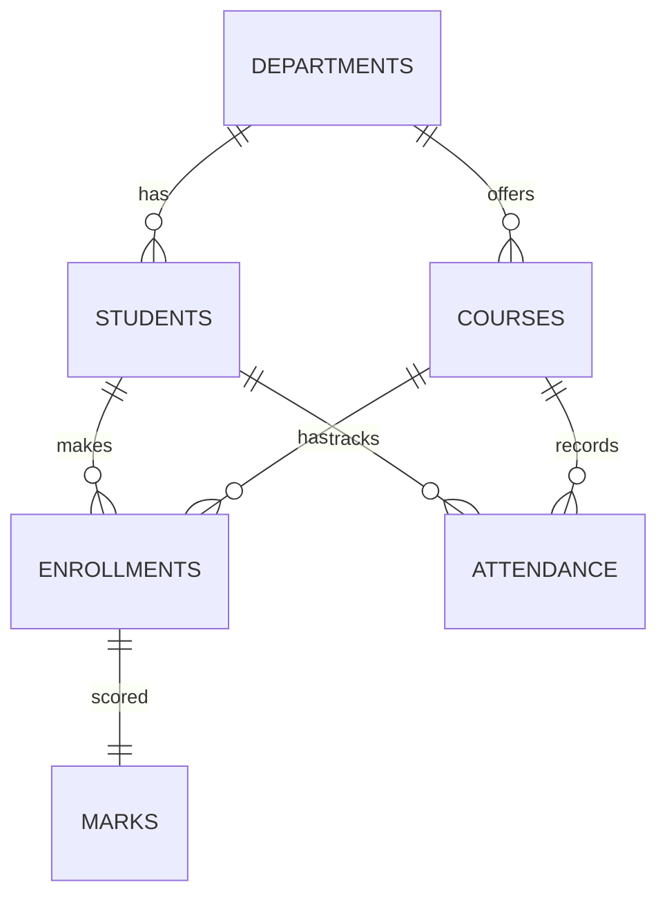

ER Model
1. Definition
ER diagram shows entities (tables), attributes (columns), keys, relationships.
2. Why
Blueprint before CREATE TABLE; exams ask to draw college ER.
3. Syntax (Mermaid)

4. Explained
Rect=entity, oval=attribute, underlined=PK, arrow=FK. ||--o{ = one-to-many. ||--|| = one-to-one. Enrollments, Attendance are associative/junction.
5. Examples
Ex1 Departments(dept_id PK, dept_name, hod). Ex2 Students(student_id PK, name, dept_id FK). Ex3 Courses(course_id PK, dept_id FK). Ex4 Enrollments(PK enrollment_id, FKs student/course, UQ triple). Ex5 Marks(FK enrollment_id UQ =1-1). Ex6 Attendance(FKs student/course, UQ pair, generated percentage).
Map row: Abhishek(1)->dept 1; enr 1->course 1; mark 1->enr 1.
6. Changes
Diagram only; CREATE follows it.
7. Steps
Entities, keys, FK lines, cardinality, then DDL.
8. Mistakes
1 M-N direct line (need junction). 2 Missing UQ on 1-1. 3 Wrong cardinality. 4 Attribute on wrong entity (dept_name in students). 5 No PK.
9. Exam
Draw 6 entities; junction keys; 1-M vs M-N; PK/FK notation.
10. Practice 5Q
Q1 Entities? A 6 listed. Q2 Junctions? A enrollments, attendance. Q3 Dept-Students line? A 1-M. Q4 Marks line? A 1-1. Q5 Map Abhishek DBMS? A s1-e1-c1-m1.
11. Revision
Entities+keys+junction; Mermaid above matches schema.

